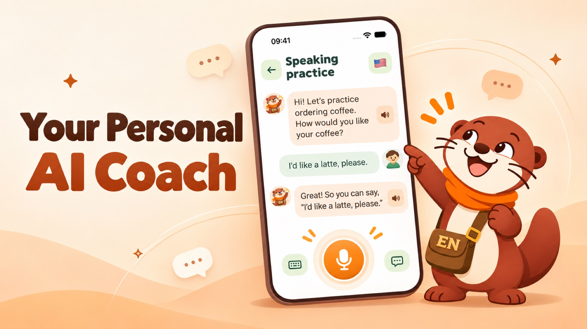

# HiPlip Open Conversation

A small, self-hostable web app for practising spoken English with your own AI provider.



[Explore the full HiPlip English learning site](https://hiplipenglish.io/)

## Features

- Learn: three A1 samples: Greetings, Introducing Yourself, and Ordering Food.
- Practice: three questions per lesson with explanations and a score. Learn and Practice work without an API key.
- Free conversation with short corrections and follow-up questions.
- Typed replies, optional browser speech recognition, and playback.
- API settings with an endpoint, model, session-only key, and a connection test.

## Getting Started

Use Node.js 20 or later. From the repository directory, run:

```sh
npm start
```

Open http://127.0.0.1:3072. Under **API settings**, enter an OpenAI-compatible API base URL, model and key. Test the connection, save, and try saying or typing “I’d like to order a coffee, please.”

The browser sends conversation text and the credential directly to the endpoint you choose. Use a trusted endpoint and a scoped key. The provider must allow browser requests from your app’s origin, including CORS preflight. The application keeps settings in memory until reload. Browser speech recognition may use a service supplied by the browser.

Run `npm test` to check the API request and response contract.

## Project Structure

- `public/` contains the interface, the sample lesson, browser speech integration and the API client.
- `serve.mjs` serves the application on loopback.
- `provider.test.mjs` checks endpoint validation and the AI request contract.

## License

The source code is available under the [MIT License](LICENSE). HiPlip branding and the included promotional artwork are reserved and provided for display in this project.

## Optional integrations

Settings include English and Simplified Chinese navigation, a separate tutor explanation language, and playback speed from 0.5× to 1.5×. Sample study text stays in English. Word Match uses the vocabulary of the selected sample lesson.

- **Stripe subscriptions:** Set `STRIPE_PAYMENT_LINK` to your Stripe recurring Payment Link and `STRIPE_PORTAL_LINK` to your hosted customer portal login link before starting the server. These links are optional. Stripe handles checkout and subscription management. This sample does not grant app entitlements or handle webhooks.
- **Firebase Analytics:** Set `FIREBASE_PROJECT_ID`, `FIREBASE_MEASUREMENT_ID`, `FIREBASE_API_KEY` and `FIREBASE_APP_ID` to your Firebase web app’s public config. Enable Analytics for that app. Users can opt in from Settings. Custom events contain event names only, and no conversation text or provider credentials. Firebase Authentication is outside this integration.
